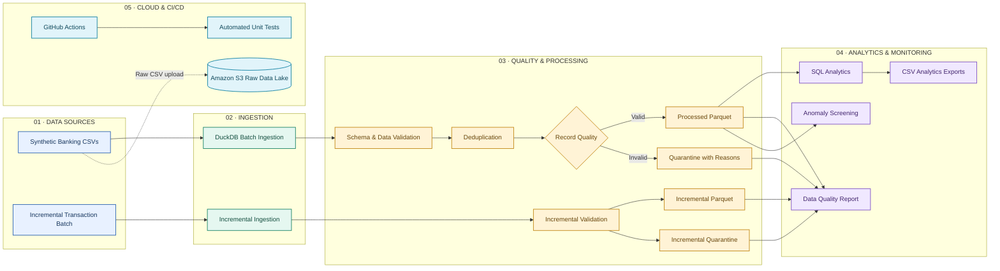

# AI-Enhanced Banking Data Platform

A banking data engineering portfolio project built with Python, DuckDB, SQL, Parquet, and Amazon S3. It demonstrates batch ETL, incremental processing, data quality controls, analytics, anomaly screening, automated testing, and cloud object storage using synthetic banking data.

## Architecture



## Demonstrated Results

### Main ETL Pipeline
- 500 customer records processed.
- 10,004 raw transaction rows received.
- 10,003 rows remaining after deduplication.
- 10,000 valid transactions written to Parquet.
- 3 records quarantined with rejection reasons.
- Reconciliation check passed.

### Incremental Processing
- 4 incoming transactions processed.
- 2 valid transactions produced.
- 2 records quarantined.
- Duplicate detection and customer-reference validation implemented.

### Analytics and Quality
- Daily transaction summary.
- Transaction status summary.
- Customer-level transaction summary.
- JSON data quality report with reconciliation and duplicate checks.
- Threshold-based anomaly screening.
- 9 automated unit tests passing locally and in GitHub Actions.

### AWS S3 Integration
- Region: Asia Pacific (Sydney), `ap-southeast-2`.
- Private S3 bucket with Block Public Access enabled.
- SSE-S3 encryption.
- Dedicated IAM user with restricted upload permissions.
- Three synthetic CSV files uploaded and verified under `banking-data/raw/`.
- S3 upload is optional in the end-to-end demo.

### Run Locally

Run the pipeline and tests without uploading to S3:

```powershell
.\.venv\Scripts\python.exe .\src\demo.py
```

Preview S3 upload destinations:

```powershell
$env:BANKING_S3_BUCKET = "<your-bucket-name>"
.\.venv\Scripts\python.exe .\src\s3_ingestion.py
```

Upload raw CSV files:

```powershell
.\.venv\Scripts\python.exe .\src\s3_ingestion.py --upload
```

Run the pipeline and upload raw files after successful tests:

```powershell
.\.venv\Scripts\python.exe .\src\demo.py --upload-s3
```

### Engineering Practices
- Modular Python scripts and SQL transformations.
- Parquet-based processed datasets.
- Incremental ingestion and quarantine handling.
- Automated unit tests and GitHub Actions CI.
- Git version control.
- Synthetic data only; no real banking data.
- Cloud usage kept minimal and monitored against available AWS credits.