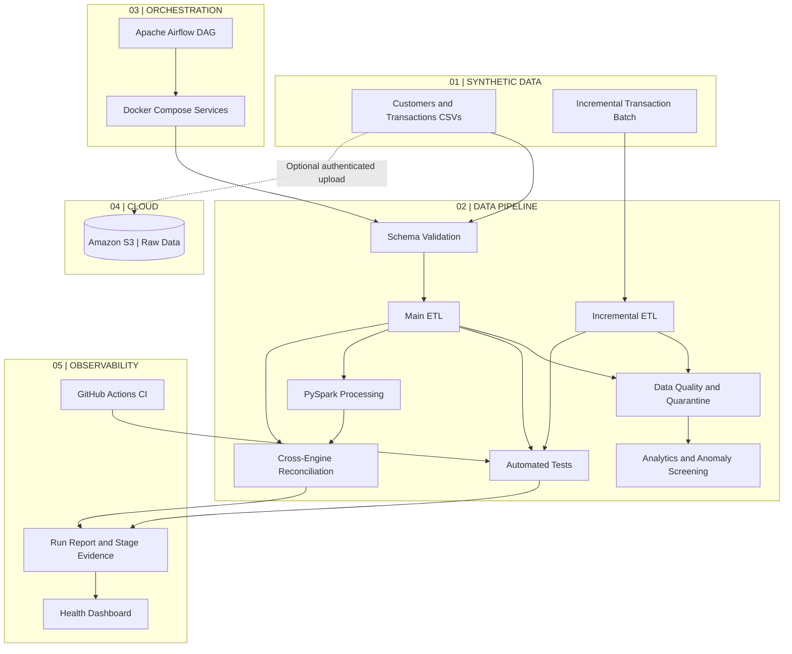

# AI-Enhanced Banking Data Platform

[](https://github.com/Vaishnav-K/ai-enhanced-banking-data-platform/actions/workflows/ci.yml)
[](https://github.com/Vaishnav-K/ai-enhanced-banking-data-platform/actions/workflows/spark-ci.yml)
[](https://github.com/Vaishnav-K/ai-enhanced-banking-data-platform/actions/workflows/deploy-portfolio.yml)

A reproducible, synthetic banking data platform that demonstrates more than a basic ETL job: **data validation, batch and incremental processing, independent-engine reconciliation, traceable run evidence, and evidence-based operational diagnostics**.

Built with **Python, DuckDB, SQL, Parquet, PySpark, Apache Airflow, Docker, and Amazon S3**. The project is designed to be explored locally without AWS credentials; S3 upload and the Airflow end-to-end path are optional, explicitly enabled workflows.

## Project at a glance

| Engineering concern | What is implemented | Evidence to inspect |
|---|---|---|
| Data correctness | Schema and value validation, deduplication, referential checks, quarantine with rejection reasons | Quality reports and Parquet outputs |
| Batch + incremental ETL | Initial transaction processing plus duplicate-aware incremental ingestion | Main and incremental pipeline reports |
| Independent processing paths | DuckDB processing compared with PySpark output | Cross-engine reconciliation report |
| Operational traceability | Run IDs, stage attempts, bounded retries, artifact observations and lineage | `data/processed/pipeline_run_report.json` and lineage reports |
| Quality and recovery intelligence | Threshold-based anomaly screening, quality investigation, read-only recovery assessments | Investigation and recovery reports |
| Orchestration and cloud | Airflow preflight → pipeline execution → evidence validation; opt-in checksum-aware S3 ingestion | Airflow task logs, run report, validated artifacts, and S3 audit |
| Engineering controls | Unit tests and separate CI for the core pipeline and Spark | GitHub Actions badges above |

### Demonstrated sample run

These results come from the project's **synthetic banking dataset**, not real customer records or a production workload.

| Main pipeline measure | Observed result |
|---|---:|
| Synthetic customers | 500 |
| Raw transaction rows | 10,004 |
| Rows after transaction-ID deduplication | 10,003 |
| Valid transactions written to Parquet | 10,000 |
| Quarantined records with rejection reasons | 3 |
| Reconciliation check | Passed |

The incremental sample contains 4 incoming transactions, producing 2 valid rows and 2 quarantined rows. See the detailed results and limitations below.

### Quick start — local run

From PowerShell on Windows, with Python 3.12 installed:

```powershell
git clone https://github.com/Vaishnav-K/ai-enhanced-banking-data-platform.git
Set-Location .\ai-enhanced-banking-data-platform
powershell -ExecutionPolicy Bypass -File .\scripts\setup.ps1
.\.venv312\Scripts\python.exe .\src\generate_data.py
.\.venv312\Scripts\python.exe .\src\demo.py
```

The local pipeline uses synthetic data and does not require S3 credentials. For the full orchestration demo, continue to **Run with Airflow and Docker** below.

### Best way to review the project

1. Read the [architecture and design principles](docs/architecture.md).
2. Follow the [end-to-end demo walkthrough](docs/demo-walkthrough.md).
3. Run the local demo and inspect `data/processed/pipeline_run_report.json`.
4. Generate and open the platform health dashboard using the command later in this README.
5. Review the separate [core pipeline CI](https://github.com/Vaishnav-K/ai-enhanced-banking-data-platform/actions/workflows/ci.yml) and [Spark CI](https://github.com/Vaishnav-K/ai-enhanced-banking-data-platform/actions/workflows/spark-ci.yml) runs.

## Architecture



The Airflow DAG checks dependencies and inputs, runs the existing pipeline with Spark enabled, and independently validates the new run report, cross-engine reconciliation result, and required output artifacts. S3 raw-file ingestion is controlled by the DAG's `upload_s3` parameter and is disabled by default.

## Demonstrated Results

### Main ETL Pipeline
- 500 synthetic customer records.
- 10,004 raw transaction rows received.
- 10,003 rows remaining after deduplication.
- 10,000 valid transactions written to Parquet.
- 3 records quarantined with rejection reasons.
- Reconciliation check passed.

### Incremental Processing
- 4 incoming transactions processed.
- 2 valid transactions produced.
- 2 records quarantined.
- Duplicate detection and customer-reference validation implemented.

### Analytics and Quality
- Daily transaction summary.
- Transaction status summary.
- Customer-level transaction summary.
- JSON data quality report with reconciliation and duplicate checks.
- Threshold-based anomaly screening.
- Automated unit tests run locally and in GitHub Actions.

### AWS S3 Integration
- Region: Asia Pacific (Sydney), `ap-southeast-2`.
- Private S3 bucket with Block Public Access enabled.
- SSE-S3 encryption.
- Dedicated IAM user intended for restricted upload permissions.
- Raw synthetic CSVs stored under `banking-data/raw/`.
- Upload uses SHA-256 checksums, skips unchanged files, uploads changed or missing files, verifies uploads, and records results.
- The local pipeline and default Airflow run do not require S3; the Airflow DAG adds `--upload-s3` only when its `upload_s3` parameter is enabled.

### Airflow + Docker + Spark execution
- Apache Airflow 3.1.7 with Docker Compose and a custom image containing the project source, Java 17, and PySpark 3.5.7.
- DAG: `banking_data_platform_pipeline`.
- Task chain: `preflight_pipeline_inputs` → `run_banking_pipeline` → `validate_pipeline_evidence`.
- Preflight checks required synthetic inputs, project scripts, configuration files, and runtime dependencies before execution.
- The runner invokes `src/demo.py --include-spark`; S3 upload is opt-in through the DAG's `upload_s3` parameter, which defaults to `false`.
- Post-run validation checks the run ID, stage statuses and counters, cross-engine reconciliation report, and required output artifacts. When S3 is enabled, it also validates fresh audit records for the raw input files.
- The DAG allows one active run because executions share local output and lineage stores. The existing demo runner owns bounded stage-level retries; Airflow does not automatically replay the entire pipeline after a partial run.

## Run Locally

Use Python 3.12 and the project virtual environment.

Run the pipeline without uploading to S3:

```powershell
.\.venv312\Scripts\python.exe .\src\demo.py
```

Run the end-to-end demo wrapper:

```powershell
powershell -ExecutionPolicy Bypass -File .\scripts\run_demo_with_report.ps1
```

Preview S3 upload destinations:

```powershell
$env:BANKING_S3_BUCKET = "<your-bucket-name>"
.\.venv312\Scripts\python.exe .\src\s3_ingestion.py
```

Upload raw CSV files:

```powershell
$env:BANKING_S3_BUCKET = "<your-bucket-name>"
.\.venv312\Scripts\python.exe .\src\s3_ingestion.py --upload
```

Run the pipeline and upload raw files after successful stages/tests:

```powershell
$env:BANKING_S3_BUCKET = "<your-bucket-name>"
.\.venv312\Scripts\python.exe .\src\demo.py --upload-s3
```

## Run with Airflow and Docker

Prerequisites:
- Docker Desktop running.
- The repository cloned locally.
- No AWS credentials are needed for the default local Airflow run.

Start Airflow from PowerShell:

```powershell
Set-Location .\orchestration\airflow
docker compose config --quiet
docker compose up --build -d
```

Open `http://localhost:8080`, sign in with the Airflow account configured for your local environment, unpause `banking_data_platform_pipeline` if needed, and trigger a manual run. The `upload_s3` trigger parameter defaults to `false`; leave it disabled for a local-only run.

To opt into S3, set `BANKING_S3_BUCKET`, `AWS_ACCESS_KEY_ID`, and `AWS_SECRET_ACCESS_KEY` in the PowerShell environment before starting Compose. The credentials are passed only to the worker container. For example, load the default profile without displaying its values:

```powershell
$awsCreds = Get-Content "$env:USERPROFILE\.aws\credentials" -Raw
$section = [regex]::Match($awsCreds, '(?ms)^\[default\]\s*(.*?)(?=^\[|\z)').Groups[1].Value
$accessKey = [regex]::Match($section, '(?m)^\s*aws_access_key_id\s*=\s*(\S+)').Groups[1].Value
$secretKey = [regex]::Match($section, '(?m)^\s*aws_secret_access_key\s*=\s*(\S+)').Groups[1].Value
if (-not $accessKey -or -not $secretKey) { throw "Default AWS credentials not found." }

$env:AWS_ACCESS_KEY_ID = $accessKey
$env:AWS_SECRET_ACCESS_KEY = $secretKey
$env:AWS_DEFAULT_REGION = "ap-southeast-2"
$env:BANKING_S3_BUCKET = "<your-bucket-name>"
```

Then start/rebuild Compose and set `upload_s3=true` when triggering the DAG. Preflight requires the bucket setting, worker credentials, and S3 dependency. Final evidence validation checks that this run appended verified audit records for all three raw CSV inputs.

Inspect the three task logs: `preflight_pipeline_inputs`, `run_banking_pipeline`, and `validate_pipeline_evidence`. The DAG succeeds only when the pipeline and its evidence checks pass.

Do not commit `.env`, AWS credentials, or other secrets. Keep keys in the local environment and rotate them if exposed.

To stop the services without deleting persistent volumes:

```powershell
docker compose down
```

Do **not** add `-v` unless you intentionally want to remove the named data and database volumes.

## Running the Pipeline and Ingestion Reports

The pipeline and ingestion report files are stored under `data/processed/`:
- `pipeline_run_report.json` — run status and per-stage evidence.
- `ingestion_report.json` — ingestion health summary.
- `s3_ingestion_audit.jsonl` — ingestion audit events.
- `ingestion_manifest.db` — file status and checksum history.

Generate the ingestion health report:

```powershell
Set-Location ..\..
.\.venv312\Scripts\python.exe .\src\manifest_report.py
```

## Automated Tests

```powershell
.\.venv312\Scripts\python.exe -m unittest discover -s tests -v
```

S3 tests use mocked AWS responses and do not upload real objects.

## Scope and implementation boundaries

- **Synthetic data only:** generated customer and transaction records are used throughout this project.
- **Anomaly screening:** the current implementation uses configured thresholds and deterministic rules; it is not a trained fraud-detection model.
- **Investigation and recovery:** findings and recovery suggestions are evidence-driven and read-only. They do not automatically restart jobs or remediate production systems.
- **AI boundary:** this version does not require an LLM API or include a connected generative-AI agent. The current strengths are data engineering, diagnostics, and decision support; a model-backed capability would be a separately scoped extension.
- **Cloud boundary:** local tests and the default Airflow run do not require AWS. Only the opt-in S3 upload needs a bucket and worker credentials.
- **Performance claims:** sample row counts are measured from the project's generated data; they are not evidence of production-scale throughput or an SLA.

## Portfolio Documentation

- [Airflow orchestration runbook](docs/airflow-orchestration.md)

- [Architecture and design principles](docs/architecture.md)
- [End-to-end demo walkthrough](docs/demo-walkthrough.md)
- Dashboard generator: `src/platform_dashboard.py`
- Executive health summary: `src/platform_health_demo.py`

Generate the dashboard:

```powershell
.\.venv312\Scripts\python.exe src\platform_dashboard.py
```

Open `reports/platform_health_dashboard.html` in a browser. The dashboard is generated from local pipeline evidence and can be refreshed by rerunning the command.

The project uses synthetic banking data. Review the actual run evidence and documented limitations before interpreting metrics as production guarantees.


## AWS Athena validation evidence

The existing curated Parquet datasets were also queried through Amazon Athena using the AWS Glue Data Catalog. The recorded development run validated 500 customer rows and 10,000 transaction rows, confirmed 10,000 distinct transaction IDs, produced a transaction-status breakdown, ran customer/transaction join analytics, and returned zero issues for the selected null, negative-amount, and orphan-transaction checks.

- **[AWS Athena + S3 validation report](docs/aws-athena-s3-validation.md)** — schemas, observed results, limitations, and reproduction steps.
- **[Reproducible Athena SQL](sql/athena_validation.sql)** — external-table DDL and validation queries.

These are results from synthetic data and a development run, not production metrics. The report does not expose the bucket name, credentials, or private AWS configuration. To reproduce the queries, point the SQL at a bucket you control and configure Athena's query-results S3 location.


## 10-million-transaction scale experiment

An isolated scale benchmark is available to generate a larger synthetic dataset and process it through Spark without overwriting the baseline demo data.

- **[10-million-transaction benchmark instructions](docs/scale-benchmark-10m.md)** — generation, validation, Spark execution, output inspection, and safe evidence publication.
- Scale generator: `src/generate_scale_data.py`
- Spark benchmark: `src/scale_spark_benchmark.py`

The scale generator defaults to **100,000 customers and 10,000,000 transactions** and writes to `data/scale/raw`, keeping the 500-customer / 10,000-transaction baseline mock under `data/raw` unchanged. It refuses to overwrite existing scale input files unless `--overwrite` is supplied.

Generate the default 10M mock:

```powershell
.\.venv312\Scripts\python.exe .\src\generate_scale_data.py
```

### Measured local Spark run

A completed run processed **10,000,000 synthetic transactions** with Spark 3.5.7 on `local[2]` and 16 shuffle partitions.

| Measure | Observed result |
|---|---:|
| Customers | 100,000 |
| Raw transactions | 10,000,000 |
| Deduplicated transactions | 10,000,000 |
| Valid transactions | 10,000,000 |
| Quarantined transactions | 0 |
| Reconciliation | **PASS** |
| Elapsed time | 356.266 seconds |
| Throughput | **28,068.91 raw transactions/second** |

Elapsed time includes Spark startup, reads, transformations, writes, and analytics. This is a **local synthetic-data benchmark**, not production workload evidence or an SLA. The run used CSV output on Windows and does not demonstrate Parquet-write performance.

- **[Sanitized benchmark results](reports/scale-benchmark-10m-results-public.json)** — measured counts, runtime, configuration, output sizes, and limitations.
- **[Benchmark instructions and methodology](docs/scale-benchmark-10m.md)** — reproduce the experiment and inspect the evidence.

Generated CSV and Parquet datasets should remain out of Git.
