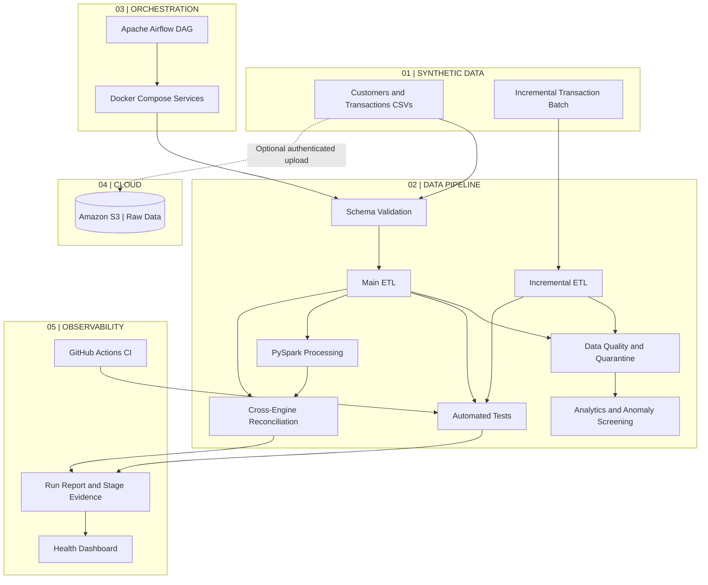

# AI-Enhanced Banking Data Platform

A synthetic banking data engineering portfolio project built with Python, DuckDB, SQL, Parquet, PySpark, Apache Airflow, Docker, and Amazon S3. It demonstrates batch ETL, incremental processing, data quality controls, analytics, anomaly screening, runtime reconciliation, pipeline observability, automated testing, and cloud object storage.

## Architecture



The Airflow DAG runs the existing pipeline with Spark enabled and requests raw-file S3 ingestion. The pipeline writes a run report; Airflow validates the report status and fails the task if the process fails, the report is missing, or the reported status is not `PASS`.

## Demonstrated Results

### Main ETL Pipeline
- 500 synthetic customer records.
- 10,004 raw transaction rows received.
- 10,003 rows remaining after deduplication.
- 10,000 valid transactions written to Parquet.
- 3 records quarantined with rejection reasons.
- Reconciliation check passed.

### Incremental Processing
- 4 incoming transactions processed.
- 2 valid transactions produced.
- 2 records quarantined.
- Duplicate detection and customer-reference validation implemented.

### Analytics and Quality
- Daily transaction summary.
- Transaction status summary.
- Customer-level transaction summary.
- JSON data quality report with reconciliation and duplicate checks.
- Threshold-based anomaly screening.
- Automated unit tests run locally and in GitHub Actions.

### AWS S3 Integration
- Region: Asia Pacific (Sydney), `ap-southeast-2`.
- Private S3 bucket with Block Public Access enabled.
- SSE-S3 encryption.
- Dedicated IAM user intended for restricted upload permissions.
- Raw synthetic CSVs stored under `banking-data/raw/`.
- Upload uses SHA-256 checksums, skips unchanged files, uploads changed or missing files, verifies uploads, and records results.
- The local pipeline can run without S3; the Airflow demo invokes the pipeline with `--upload-s3`.

### Airflow + Docker + Spark execution
- Apache Airflow 3.1.7 with Docker Compose and a custom image.
- The image includes the banking project source, Java 17, and PySpark 3.5.7.
- DAG: `banking_data_platform_pipeline`.
- Task: `run_and_validate_pipeline`.
- DAG invokes `src/demo.py --include-spark --upload-s3`.
- Airflow checks the process exit code and the generated `data/processed/pipeline_run_report.json`.
- A successful run was recorded with overall status `PASS`; the `S3 Raw Data Ingestion` stage also reported `PASS` with exit code `0`. Treat these as development-demo evidence, not a production SLA.

## Run Locally

Use Python 3.12 and the project virtual environment.

Run the pipeline without uploading to S3:

```powershell
.\.venv312\Scripts\python.exe .\src\demo.py
```

Run the end-to-end demo wrapper:

```powershell
powershell -ExecutionPolicy Bypass -File .\scripts\run_demo_with_report.ps1
```

Preview S3 upload destinations:

```powershell
$env:BANKING_S3_BUCKET = "<your-bucket-name>"
.\.venv312\Scripts\python.exe .\src\s3_ingestion.py
```

Upload raw CSV files:

```powershell
$env:BANKING_S3_BUCKET = "<your-bucket-name>"
.\.venv312\Scripts\python.exe .\src\s3_ingestion.py --upload
```

Run the pipeline and upload raw files after successful stages/tests:

```powershell
$env:BANKING_S3_BUCKET = "<your-bucket-name>"
.\.venv312\Scripts\python.exe .\src\demo.py --upload-s3
```

## Run with Airflow and Docker

Prerequisites:
- Docker Desktop running.
- AWS CLI configured locally with a default credentials profile authorized for the target bucket.
- The repository cloned locally.

The Compose configuration expects `AWS_ACCESS_KEY_ID` and `AWS_SECRET_ACCESS_KEY` in the PowerShell environment for the worker. Load them from the local AWS credentials file without printing them:

```powershell
Set-Location .\orchestration\airflow

$awsCreds = Get-Content "$env:USERPROFILE\.aws\credentials" -Raw
$section = [regex]::Match($awsCreds, '(?ms)^\[default\]\s*(.*?)(?=^\[|\z)').Groups[1].Value
$accessKey = [regex]::Match($section, '(?m)^\s*aws_access_key_id\s*=\s*(\S+)').Groups[1].Value
$secretKey = [regex]::Match($section, '(?m)^\s*aws_secret_access_key\s*=\s*(\S+)').Groups[1].Value
if (-not $accessKey -or -not $secretKey) { throw "Default AWS credentials not found." }

$env:AWS_ACCESS_KEY_ID = $accessKey
$env:AWS_SECRET_ACCESS_KEY = $secretKey
$env:AWS_DEFAULT_REGION = "ap-southeast-2"

docker compose config --quiet
docker compose up --build -d
```

Open `http://localhost:8080`, sign in with the Airflow account configured for your local environment, unpause `banking_data_platform_pipeline` if needed, and trigger a manual run. Inspect the `run_and_validate_pipeline` task logs. The task should only pass when the pipeline process exits successfully and its report status is `PASS`.

Do not commit `.env`, AWS credentials, or other secrets. Keep the credentials in the local environment and rotate them if exposed.

To stop the services without deleting persistent volumes:

```powershell
docker compose down
```

Do **not** add `-v` unless you intentionally want to remove the named data and database volumes.

## Running the Pipeline and Ingestion Reports

The pipeline and ingestion report files are stored under `data/processed/`:
- `pipeline_run_report.json` — run status and per-stage evidence.
- `ingestion_report.json` — ingestion health summary.
- `s3_ingestion_audit.jsonl` — ingestion audit events.
- `ingestion_manifest.db` — file status and checksum history.

Generate the ingestion health report:

```powershell
Set-Location ..\..
.\.venv312\Scripts\python.exe .\src\manifest_report.py
```

## Automated Tests

```powershell
.\.venv312\Scripts\python.exe -m unittest discover -s tests -v
```

S3 tests use mocked AWS responses and do not upload real objects.

## Portfolio Documentation

- [Architecture and design principles](docs/architecture.md)
- [End-to-end demo walkthrough](docs/demo-walkthrough.md)
- Dashboard generator: `src/platform_dashboard.py`
- Executive health summary: `src/platform_health_demo.py`

Generate the dashboard:

```powershell
.\.venv312\Scripts\python.exe src\platform_dashboard.py
```

Open `reports/platform_health_dashboard.html` in a browser. The dashboard is generated from local pipeline evidence and can be refreshed by rerunning the command.

The project uses synthetic banking data. Review the actual run evidence and documented limitations before interpreting metrics as production guarantees.
