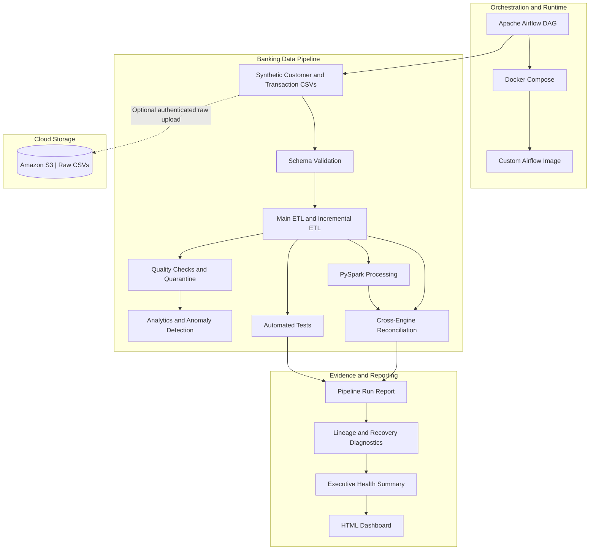

# Banking Data Platform — Architecture

## End-to-end flow



## Runtime orchestration

The Airflow DAG is defined in `orchestration/airflow/dags/banking_data_platform_pipeline.py`. It runs the existing project pipeline with Spark and S3 ingestion enabled:

```text
src/demo.py --include-spark --upload-s3
```

The DAG uses one Python task to launch the pipeline process. It removes any previous run report before execution, checks the subprocess exit code, requires a newly generated report, parses the JSON, and raises an Airflow exception unless the report status is `PASS`. This prevents a stale successful report from masking a failed process.

The custom image in `orchestration/airflow/Dockerfile` includes the project source, Java 17, project Python dependencies, and PySpark 3.5.7. Docker Compose runs the Airflow services and preserves the project `data/` directory in a named volume.

## Data and cloud boundaries

- The dataset is synthetic; no real banking customer data is used.
- The local pipeline can run without S3 access.
- S3 ingestion uses the configured bucket in `ap-southeast-2`.
- AWS credentials are provided to the worker through the local environment; secrets must not be committed to Git.
- The raw data upload is distinct from the local ETL outputs and reporting artifacts.

## Design principles

- **Reproducible data:** synthetic banking data supports development without real customer records.
- **Data validation:** schema and quality checks identify issues before downstream use.
- **Incremental processing:** incremental ETL supports processing changes rather than relying exclusively on full reloads.
- **Traceability:** recorded runs, stage attempts, artifacts, and lineage help explain pipeline outcomes.
- **Evidence-based diagnostics:** recovery recommendations and quality regression reports use recorded evidence and explicitly acknowledge missing information.
- **Operational visibility:** observability metrics and a consolidated dashboard make pipeline behavior easier to explain.
- **Safe diagnostics:** reporting and recovery assessment do not automatically restart jobs or remediate data.
- **Orchestrated execution:** Airflow coordinates the demo run and validates the resulting run report.

## Repository entry points

| Capability | Entry point |
|---|---|
| Pipeline demonstration | `src/demo.py` |
| Airflow DAG | `orchestration/airflow/dags/banking_data_platform_pipeline.py` |
| Airflow image definition | `orchestration/airflow/Dockerfile` |
| Airflow Compose configuration | `orchestration/airflow/docker-compose.yaml` |
| Runtime lineage reconciliation | `src/runtime_lineage_report.py` |
| Recovery assessment | `src/recovery_assessment.py` |
| Recovery decision engine | `src/recovery_decision_engine.py` |
| Pipeline observability | `src/pipeline_observability.py` |
| Data quality trends | `src/data_quality_trends.py` |
| Quality regression detection | `src/data_quality_regression.py` |
| Quality scorecard | `src/data_quality_scorecard.py` |
| Executive health summary | `src/platform_health_demo.py` |
| HTML dashboard generator | `src/platform_dashboard.py` |

The diagram describes the logical flow. Individual stages and integrations have different levels of runtime instrumentation; use the run report and task logs as the source of truth for a particular execution. The successful Airflow/S3 run is development evidence, not a production SLA or proof of production-scale operation.
