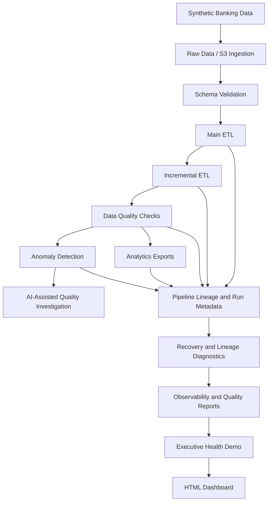

# Banking Data Platform — Architecture

## End-to-end flow

## Design principles

- **Reproducible data:** synthetic banking data supports development without requiring real customer records.
- **Data validation:** schema and quality checks identify issues before downstream use.
- **Incremental processing:** incremental ETL supports processing changes rather than relying exclusively on full reloads.
- **Traceability:** recorded runs, stage attempts, artifacts, and lineage help explain pipeline outcomes.
- **Evidence-based diagnostics:** recovery recommendations and quality regression reports use recorded evidence and explicitly acknowledge missing information.
- **Operational visibility:** observability metrics and a consolidated dashboard make pipeline behavior easier to explain.
- **Safe diagnostics:** reporting and recovery assessment do not automatically restart jobs or remediate data.

## Repository entry points

| Capability | Entry point |
|---|---|
| Pipeline demonstration | `src/demo.py` |
| Runtime lineage reconciliation | `src/runtime_lineage_report.py` |
| Recovery assessment | `src/recovery_assessment.py` |
| Recovery decision engine | `src/recovery_decision_engine.py` |
| Pipeline observability | `src/pipeline_observability.py` |
| Data quality trends | `src/data_quality_trends.py` |
| Quality regression detection | `src/data_quality_regression.py` |
| Quality scorecard | `src/data_quality_scorecard.py` |
| Executive health summary | `src/platform_health_demo.py` |
| HTML dashboard generator | `src/platform_dashboard.py` |

The diagram describes the intended logical flow. Individual stages and integrations may have different levels of runtime instrumentation; see the reports and code for their actual coverage.
